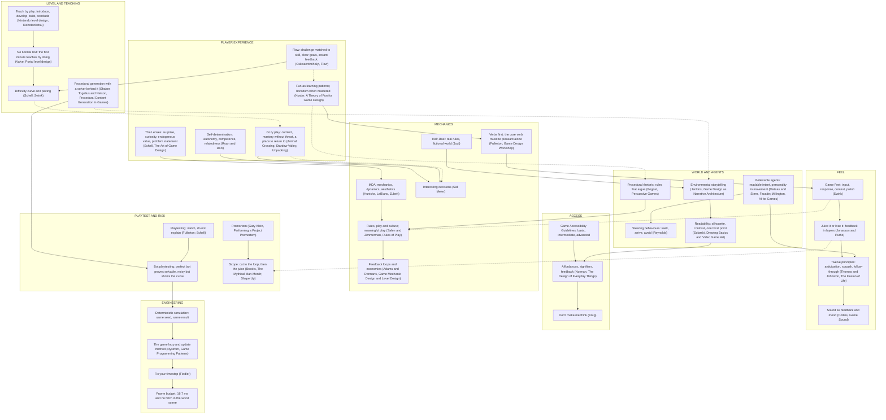

# GDADA game-design anchor graph

Solid arrows ground or extend; dotted arrows are counterpoints. Copy labels exactly. Status classes for a live graph:
`visited`, `kept`, `adapted`, `scrapped`.

## Panel seats (one authority per seat)

| Seat | Work | What it argues from |
|---|---|---|
| Flow | Csikszentmihalyi, *Flow* | Is challenge matched to skill, are goals clear, is feedback instant? |
| Learner | Koster, *A Theory of Fun* | What pattern is the player learning, and when is it mastered? |
| Lenses | Schell, *The Art of Game Design* | Surprise, curiosity, endogenous value; the problem statement |
| Rules | Salen and Zimmerman, *Rules of Play* | Does each rule earn its place; is the play meaningful? |
| Feel | Swink, *Game Feel* | Input, response and polish; what does the verb feel like alone? |
| Decisions | Meier, interesting decisions | What is the player choosing, and does it cost something? |
| Rhetoric | Bogost, *Persuasive Games* | What do the rules say, and does the theme agree? |
| Affordance | Norman, *The Design of Everyday Things* | Can a stranger tell what is clickable and what happened? |
| Access | Game Accessibility Guidelines | Who cannot play this, and what is the cheapest fix? |
| Agents | Reynolds and Mateas, believable agents | Do the characters read as alive: intent, personality, no jitter? |
| Engineer | Nystrom and Fiedler | Is the loop stable, deterministic and inside the frame budget? |
| Cut | Brooks, scope | What can go and leave the loop standing? |
| Premortem | Klein | How does this fail with a real player? |

Dotted pairs usable for the mode rule: Feel and Rules, Learner and Rhetoric, Flow and Learner, Decisions and Cozy.
